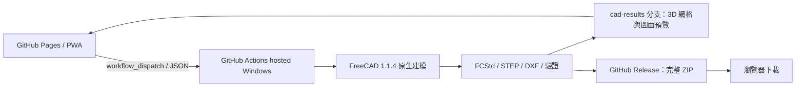

# RD065 CAD Cloud 2.0.1

部署目標：`maxjimtech/maxjimtech.github.io`。網頁放在 `services/cad-cloud/`，原生來源與雲端連接層放在 `cad-cloud/`，兩份工作流程放在 `.github/workflows/`。沿用原網站的分支式 Pages，不替換既有首頁及網站。`main` 的相關來源更新會自動執行一次預設 RD065 雲端驗證。驗證完成前不宣稱首跑通過。

GitHub Pages 提供可安裝網頁（PWA），GitHub Actions 的 **GitHub 託管 Windows 執行器** 負責 FreeCAD 計算與工程圖。使用端不安裝 Python／FreeCAD，也不執行本機 CAD。瀏覽器只處理表單、API 通訊及成果顯示。

目前為待部署原始碼：尚未指定遠端儲存庫，尚未宣稱 GitHub 上線或雲端重建通過。舊桌面程式與舊 CAD 交付保留原樣。

## 架構

本版不是常駐伺服器：工作需等候 GitHub 排程、下載 FreeCAD 及建模。工作期限 90 分鐘，實際時間須以雲端首跑量測。GitHub 執行額度與成果儲存依帳號方案；不會建立付費主機或自架 runner。

## 一次性部署

1. 將本目錄內容放入選定儲存庫的 `main` 分支根目錄，包含隱藏目錄 `.github`。不要上傳原始 DWG、DFT 或歷史交付 ZIP。
2. Settings → Pages → Build and deployment 選 **GitHub Actions**。
3. Actions → Publish CAD Cloud → Run workflow。成功後 `github-pages` Environment 會顯示真實網站網址。
4. 確認 Actions 允許本案使用的官方 actions 與工作所需的 Contents write 權限。`cad.yml` 只在手動/API 要求時產生模型，不因每次 push 自動大量建模。
5. 在 GitHub 個人設定建立 fine-grained PAT，僅選定此儲存庫：**Actions Read and write、Contents Read-only**。不要把權杖放入程式、README、Actions inputs 或聊天訊息。
6. 開啟網站 → 連線設定 → 儲存庫／分支／PAT → 驗證並連線。分支必須已存在，`cad.yml` 必須先在預設分支。權杖僅存在本頁面記憶體；重新開頁需重新登入。
7. 用預設 RD065 產生首個工作，核對雲端執行結果、實體、STEP、DXF 與預覽，通過後才認定部署完成。

GitHub Pages 的可見性由帳號方案與設定決定。若儲存庫公開，程式、凸輪剖面資料與 `cad-results` 預覽也公開；需保密時使用支援私有儲存庫 Pages 的方案或把 `web/` 放到已有雲端主機，後端仍使用私有 GitHub Actions。不要默認公開原始設計。

## 使用

- 輸入需求、匯入／匯出條件 JSON、提交雲端工作。
- 自動每 20 秒更新目前頁面的工作。工作仍在 GitHub 執行，關閉頁面不會取消；同一瀏覽器保留工作編號。跨裝置可在 GitHub Actions／Releases 找到工作。
- 完成後「載入模型與圖面」：3D 來自保存後的 Assembly.step 實體三角化，2D 來自實際輸出 DXF；不是預先畫好的示意圖。
- 「下載 FCStd／STEP／DXF」前往該工作的 GitHub Release，下載 CAD-delivery.zip。私有儲存庫需在 GitHub 網站使用有權限帳號登入。Actions Artifact 保留 30 天，Release 與結果分支持續保留，需由管理者定期清理。
- Chrome／Edge 可使用「安裝網頁程式」，支援的瀏覽器也可從選單安裝。安裝的只是網頁外殼；**沒有網路就不能建模**。
- 原生檔的 FeaturePython 需要同包 `native_features.py`；使用同包 `OpenGenerated.FCMacro` 在 FreeCAD 開啟。使用端若只使用預覽與 STEP／DXF 下載，不需裝 CAD。

## 輸出與驗證

每個雲端工作輸出 FCStd、四份 STEP（三個零件及組立）、四張 DXF、四張圖面 PNG、3D preview.json、需求 JSON、BOM、關聯尺寸紀錄、驗證 JSON 與 SHA256 清單。完整 ZIP 另經 CRC 檢查。建模失敗只保留失敗紀錄／Artifact，不當成成功模型。

固定 FreeCAD 官方版本 1.1.4；雲端下載 7z 並核對官方 SHA256，再用內附 Python 啟動原生模型。雲端版本與舊本機 1.1.3 有差異，首跑必須實際驗證，不能套用舊版驗收結論。

RD065 範圍：單頭等速、傳動比等於滾子數、原本固定輔助孔及軸端段落。預設外徑14滾子、凸輪外徑50、根徑32、C0.5、20:1、PCD136、軸距65。仍是審查模型；主要關聯尺寸不等於全部加工尺寸，實體螺紋牙、軸承內部、全部配合／粗糙度、公差與全週期動態驗證未完成。

## 原始碼與版本保全

- `engine/` 是原有 `FreeCAD_AutoMechanism` 指定檔案的發行快照，由 `Prepare-Release.ps1` 從唯一來源收集。不要在快照修改另一套建模核心。
- `cloud/` 是 GitHub 工作的輸入驗證、原生執行與成果發布連接層。
- `web/` 是無建置依賴的網頁與 PWA。
- `tests/` 的條件與流程測試在 GitHub 工作中執行，不在使用端啟動 CAD。
- `reports/` 保存版本來源及待完成雲端驗收狀態。

原始 CAD 資料未自動上傳；需在指定儲存庫及取得發布範圍後才實際部署。此套件不含權杖。

## 官方介面

- [GitHub workflow dispatch](https://docs.github.com/en/rest/actions/workflows#create-a-workflow-dispatch-event)
- [GitHub Pages](https://docs.github.com/en/pages/getting-started-with-github-pages/what-is-github-pages)
- [FreeCAD 官方 1.1.4 發行](https://github.com/FreeCAD/FreeCAD/releases/tag/1.1.4)
